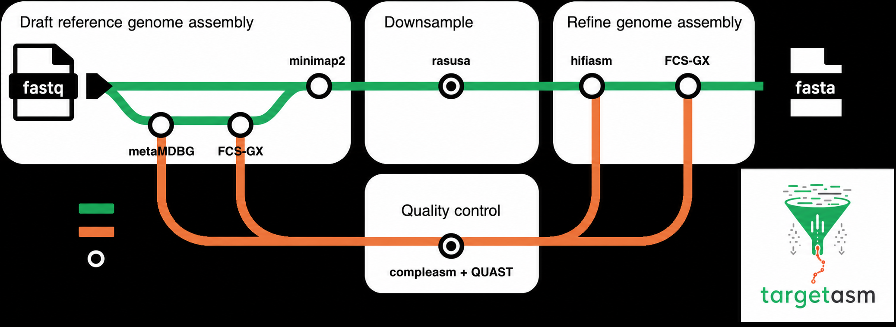

# targetasm

Target eukaryotic genome assembly from contaminated PacBio HiFi read sets.

`targetasm` is a Nextflow DSL2 workflow for recovering target eukaryotic genomes from mixed long-read sequencing libraries. It is intended for samples where the organism of interest is sequenced together with host, symbiont, microbial, environmental, or culture-associated DNA.

The workflow is reference-independent with respect to the target genome. It first assembles the full read set as a metagenome, removes non-target contigs with NCBI FCS-GX, recruits original reads that support the target-enriched draft, optionally downsamples those reads, reassembles with hifiasm, and runs a final FCS-GX screen.

The motivating benchmark was contaminated PacBio HiFi sequencing of obligate biotrophic oomycetes, but the strategy is not oomycete-specific. Any eukaryotic target with an appropriate NCBI taxonomy ID for FCS-GX can be used.

Since 0.2.0, targetasm is built on 11 pinned nf-core modules. metaMDBG stays at 1.2, which recovers more of the target genome than the module's 1.4, and Compleasm uses 0.2.10. See the [module migration notes](docs/module-migration.md) for tool versions, behavior changes, and the code that remains local.

## Workflow



1. `metaMDBG` assembles the input HiFi reads as a metagenome.
2. `FCS-GX` removes contigs outside the requested target taxon.
3. `minimap2` maps the original HiFi reads back to the cleaned draft.
4. `samtools` extracts primary mapped reads for target-enriched reassembly.
5. `rasusa` optionally downsamples mapped reads to a target base count.
6. `hifiasm` reassembles the recruited reads; `gfatools` converts the primary contigs to FASTA.
7. `FCS-GX` runs a final contamination screen.
8. Optional `Compleasm` and `QUAST` reports track assembly quality across the four assembly stages.

## Requirements

- Nextflow ≥ 26.04
- One of Docker, Singularity, Apptainer, or Conda
- PacBio HiFi reads in FASTQ format (`.fastq` or `.fq`, optionally gzipped)
- The complete NCBI FCS-GX database (about 470 GB; see the [FCS-GX download instructions](https://github.com/ncbi/fcs/wiki/FCS-GX-quickstart)) and a node with about 500 GB of RAM for the two FCS-GX screens
- An NCBI taxonomy ID for the target clade
- Optional, for assembly QC: a local Compleasm library, e.g. `compleasm download stramenopiles -L compleasm_library` (see the [Compleasm README](https://github.com/huangnengCSU/compleasm))

Tool containers and Conda environments come from the pinned nf-core modules. Parameters are validated with the `nf-schema@2.7.2` plugin against [`nextflow_schema.json`](nextflow_schema.json); unknown parameters and invalid inputs are rejected before any task starts. Run `--help` once to download the plugin before using an offline environment.

## Quick Start

Nextflow downloads the workflow from GitHub; pin a release with `-r`:

```bash
nextflow run Yixuan39/targetasm -r 0.2.1 --help
```

The Genome Biology software article used tag `0.1.0`. Release `0.2.1` is a later update; reproduce the paper with `-r 0.1.0`.

List one sample per row in a samplesheet:

```csv
reads,target_bases
/path/to/isolate1.fastq.gz,5.4e9
/path/to/isolate2.fastq,
```

Then run:

```bash
nextflow run Yixuan39/targetasm -r 0.2.1 \
  -profile singularity \
  --input samplesheet.csv \
  --gx_db /path/to/fcs-gx-db \
  --tax_id <target_ncbi_tax_id> \
  --outdir results
```

Set `--tax_id` to the NCBI taxonomy ID for the target organism or target clade. `target_bases` is the number of recruited bases kept for hifiasm: the expected genome size multiplied by the desired coverage. For example, a 90 Mb genome at 60x coverage is `5.4e9`. Leave it empty to use `--target_bases`, or to use all mapped reads when `--target_bases` is not set.

Each sample is named after its reads file (`isolate1.fastq.gz` → `isolate1`), and the name prefixes every output file. To choose different names, add a `sample` column. Names must be unique, start with a letter or number, and contain only letters, numbers, dots, underscores, and hyphens.

To change the workflow itself, clone the repository and run `nextflow run main.nf` from it.

## When to Use targetasm

Use `targetasm` when contamination is too complex for read-length filtering or whole-library assembly alone. It is designed for cases where:

- the target is a eukaryote represented by a minority or mixed fraction of reads;
- contaminant reads overlap the target reads in length or quality;
- a close reference genome is unavailable or should not drive assembly;
- taxonomic cleaning plus read recruitment is preferable to manual contig filtering.

For clean single-organism HiFi libraries, running hifiasm directly is usually enough.

## Parameters

| Parameter | Required | Default | Description |
| --- | --- | --- | --- |
| `--input` | yes | `null` | Samplesheet (`.csv` or `.tsv`) with a `reads` column and optional `sample` and `target_bases` columns. |
| `--gx_db` | yes | `null` | FCS-GX database directory. It must contain `all.gxi` and `all.gxs`, or `test-only.gxi` and `test-only.gxs`. This is the directory, not the `all` file prefix used by 0.1.0. |
| `--tax_id` | yes | `null` | NCBI taxonomy ID used as the target taxon for FCS-GX. |
| `--outdir` | yes | `.` | Output directory for published files. |
| `--target_bases` | no | `null` | Default number of bases to retain with rasusa before hifiasm reassembly (e.g. `5e9`); a samplesheet value overrides it. |
| `--rasusa_seed` | no | `0` | Random seed for rasusa. |
| `--threads` | no | `24` | CPUs for multi-threaded tasks; also sets their memory (8 GB per thread). See [Resources](#resources). |
| `--hifiasm_option` | no | `-l 2` | Extra options passed to hifiasm; `--primary` is always added. |
| `--keep_intermediates` | no | `false` | Publish intermediate assemblies and recruited reads. |
| `--quality_library` | no | `null` | Local Compleasm lineage library. Enables assembly QC when supplied. |
| `--quality_lineage` | with QC | `''` | Compleasm lineage name. |
| `--help` | no | `false` | Print parameter help and exit. |

Process resources live in [`conf/base.config`](conf/base.config); tool arguments and publishing rules live in [`conf/modules.config`](conf/modules.config). Override queues, memory, or other site settings with `-c site.config`.

## Resources

| Tasks | CPUs | Memory | Time limit |
| --- | --- | --- | --- |
| metaMDBG, minimap2, hifiasm, Compleasm, QUAST | `--threads` | 8 GB per thread (24 threads = 192 GB) | 48 h |
| FCS-GX screening | `--threads` | 500 GB | 48 h |
| samtools, FCS-GX cleaning, compression | up to 4 | 8 GB | 8 h |
| rasusa, file conversion, reports | 1 | 4 GB | 4 h |

Lower `--threads` on smaller machines to reduce memory too. The time limits leave about four times the longest runtimes seen on the downy mildew benchmark (metaMDBG took up to 13 h). A task killed by the scheduler, for example at its time limit, is retried once with twice the time; memory is not increased, so FCS-GX stays at 500 GB.

With the local executor inside a SLURM job, targetasm only uses the job's memory allocation, so request at least 500 GB for the job. Change any of these with a `-c` config, for example:

```groovy
process {
    withName: FCSGX_RUNGX  { memory = '700 GB' }
    withName: METAMDBG_ASM { time = '96h' }
}
```

## Quality Control

Add Compleasm and QUAST summaries to a full workflow run:

```bash
nextflow run Yixuan39/targetasm -r 0.2.1 \
  -profile singularity \
  --input samplesheet.csv \
  --gx_db /path/to/fcs-gx-db \
  --tax_id <target_ncbi_tax_id> \
  --quality_library /path/to/compleasm_library \
  --quality_lineage <busco_lineage> \
  --outdir results
```

When QC is enabled, targetasm evaluates the metaMDBG assembly, the first FCS-GX-cleaned assembly, the hifiasm assembly, and the final FCS-GX-cleaned assembly.

To QC existing assemblies without running the full workflow, use the standalone helper. It runs Compleasm and QUAST on each FASTA and merges the results into one table:

```bash
nextflow run run_fasta_quality_table.nf \
  --fasta '/path/to/*.fasta.gz' \
  --output quality.tsv \
  --quality_library /path/to/compleasm_db \
  --quality_lineage <busco_lineage> \
  -profile apptainer
```

## Outputs

With the default settings, the main output is:

```text
results/
  <sample>.fasta.gz
  fcs_gx/
    <sample>.fcs_initial.fcs_gx_report.txt
    <sample>.fcs_final.fcs_gx_report.txt
  pipeline_info/
    execution_trace.tsv
    software_versions.tsv
```

When `--quality_library` and `--quality_lineage` are provided:

```text
results/
  quality/
    <sample>.quality_trace.csv
    <sample>.quality_final.csv
```

When `--keep_intermediates` is set, targetasm also publishes the metaMDBG draft (`metaMDBG/`), the first FCS-GX-cleaned assembly (`fcs_gx/`), recruited reads (`minimap2/`), subsampled reads (`rasusa/`, if used), and the hifiasm assembly (`hifiasm/`).

## Profiles

| Profile | Description |
| --- | --- |
| `standard` | Local execution. |
| `slurm` | SLURM execution. |
| `docker` | Enable Docker containers. |
| `singularity` | Enable Singularity containers with automounts; also works with Apptainer. |
| `apptainer` | Enable Apptainer containers with automounts. |
| `conda` | Use Conda environments instead of containers. |
| `test` | Functional smoke test on the public UA202013 subset. Supply `--gx_db`. See [Functional test](#functional-test). |

Profiles can be combined, for example `-profile slurm,singularity`, when running on a SLURM cluster. On the HPC, the `slurm` profile is recommended because only the FCS-GX screening steps require high-memory nodes, while the remaining workflow steps can run with ordinary scheduler resources. Combine `test` with an engine profile, for example `-profile test,docker`.

## Functional test

The `test` profile is a functional smoke test of the whole pipeline. It shows that each step runs. It does not measure contamination or assembly quality: those results need the complete FCS-GX database and the full read set. Tag `0.2.1` does not contain this test; use a clone of this revision, or `-r` of the release that includes it. The paper's results remain `-r 0.1.0`.

The reads are the first 1,000 records of the public PacBio HiFi run for *Peronospora effusa* isolate UA202013 (BioProject [PRJNA745455](https://www.ncbi.nlm.nih.gov/bioproject/PRJNA745455), run [SRR15142133](https://www.ncbi.nlm.nih.gov/sra/SRR15142133); Fletcher et al. 2022, [doi:10.1094/MPMI-09-21-0227-R](https://doi.org/10.1094/MPMI-09-21-0227-R)). SRA submitted that run as a Q20 FASTQ. They are stored at `assets/testdata/UA202013.fastq.gz` (1,000 reads, 7,289,312 bases, SHA-256 `43a87a5ddafcea53a1df2d8a8130549e30ce44c3043f8034418310eb0a8d6b75`). The example samplesheet is [`assets/samplesheet_test.csv`](assets/samplesheet_test.csv). No other isolate is included. `python3 assets/fetch_ua202013_test_reads.py --check` confirms the file; without `--check`, the script rebuilds it from ENA.

Download NCBI's [test-only FCS-GX database](https://ftp.ncbi.nlm.nih.gov/genomes/TOOLS/FCS/database/test-only/test-only.manifest) (about 4.6 GB) and check each file against that manifest:

```bash
python3 assets/fetch_fcsgx_test_db.py gxdb-test
```

The files keep their `test-only.*` names. From a clone, with Docker (on Apple Silicon the `test` profile selects `linux/amd64`):

```bash
nextflow run main.nf \
  -profile test,docker \
  --gx_db "$PWD/gxdb-test" \
  --outdir results
```

From GitHub, pin the revision that contains this test:

```bash
nextflow run Yixuan39/targetasm -r <version> \
  -profile test,docker \
  --gx_db /path/to/gxdb-test \
  --outdir results
```

The profile sets the samplesheet, `--tax_id 4762` (Oomycota), `--target_bases 100000000`, `--rasusa_seed 1982`, `--threads 4`, and hifiasm `-l 2 -f 0`, and caps each task at 4 CPUs and 6 GB. `--gx_db` is the only parameter you still supply. `--outdir` is optional; the default is the launch directory. Singularity, Apptainer, or Conda can replace Docker (`-profile test,singularity`).

A completed run publishes:

```text
results/
  UA202013.fasta.gz
  fcs_gx/
    UA202013.fcs_initial.fcs_gx_report.txt
    UA202013.fcs_final.fcs_gx_report.txt
  pipeline_info/
    execution_trace.tsv
    software_versions.tsv
```

The `test` profile's 6 GB cap fits the test-only database. A run against the complete database needs the default 500 GB FCS-GX request, so use the commands in [Quick Start](#quick-start) for that, with `-r 0.1.0` when the goal is to reproduce the paper.

